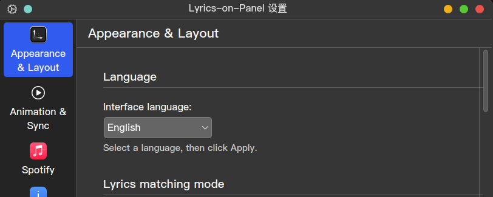
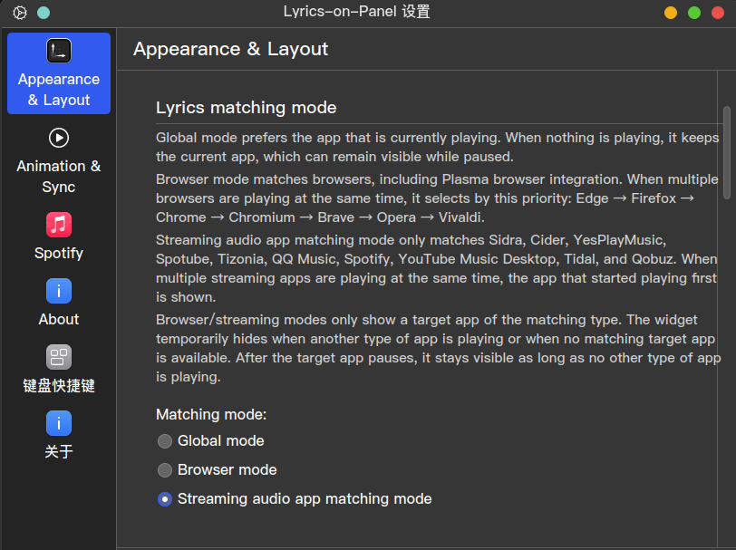
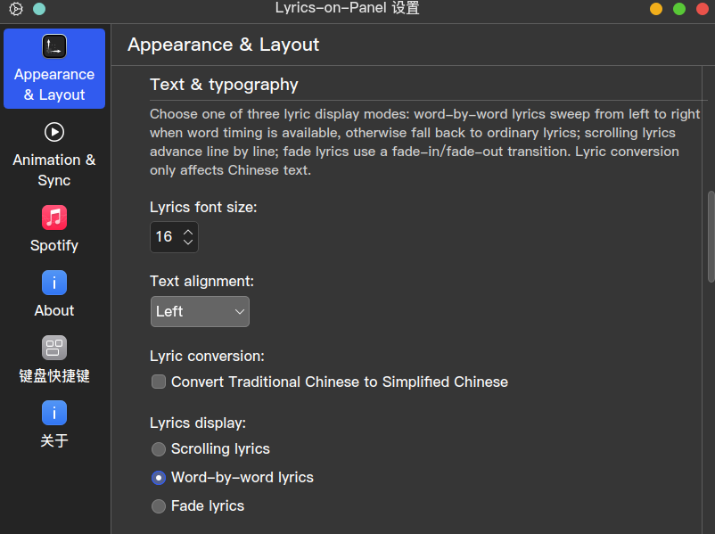
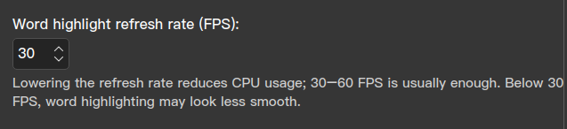

<h1 align="center">Lyrics-on-Panel-IMPRU</h1>
<p align="center">
  
</p>


<p align="center"><b>一个支持逐字歌词实时显示的 KDE 小组件</b></p>

<p align="center">
    
      
</p>


**需要安装流程?** -> [快速跳转](#安装卸载)


## 本项目的由来
此项目最初来源于 [KangweiZhu](https://github.com/KangweiZhu) 所创建 [lyrics-on-panel](https://github.com/KangweiZhu/lyrics-on-panel) 这个项目，其v3.0/3.1版本被 [bogeta329](https://github.com/bogeta329) 拉取并改进为 [lyrics-on-panel-v3](https://github.com/bogeta329/lyrics-on-panel-v3)，我则是将 [bogeta329](https://github.com/bogeta329) 的代码再拉取，并添加了一些我希望这个工具拥有的附加功能。

非常感谢上述两位开发者以及他们仓库对应的贡献者！

## 核心改进

### 1. 多语言支持
目前，该控件支持 **简体中文、繁体中文、英语、西班牙语、俄语、德语**，在配置组件的ui界面中，应该第一眼就能看到它。

我不太清楚是否还有其他语言使用者需要这个小组件，如果有需要，欢迎提交 issue !



### 2. 歌词匹配模式

支持 **全局模式、浏览器模式 和 音频串流软件匹配模式**  
选择对应的模式时，软件只会匹配你需要歌词的软件。

这主要是为了防止在刷视频、上课的时候，软件拿视频标题乱匹配歌词，造成不必要的资源浪费。




### 3. 逐字歌词和简繁转换

**简繁转换**：有些歌的词源只有繁体中文，但对我这种简体中文使用者并不是很友好（虽然表意文字不影响我理解，但是我有强迫症(doge)），软件提供了繁简转换，让和我一样有强迫症的人群舒服些😁

**逐字歌词**：我发现原来作者选择的词源大部分都支持逐字歌词，于是我添加了这个功能，也就是歌手唱到哪里，对应的歌词就高亮的一个功能。若歌词的词源不支持逐字歌词，则软件会自动回退到普通模式。



### 4. 逐字歌词帧率设置
你可以通过调整帧率来降低CPU占用，在我的测试中，30FPS足矣。



## 原有功能

### 关于 Spotify 集成
这个功能貌似有点多，因为我的网络环境我也用不上 Spotify ，所以还请参考 [bogeta329](https://github.com/bogeta329) 的 [lyrics-on-panel-v3](https://github.com/bogeta329/lyrics-on-panel-v3) 中的 Readme，我就不展开讨论了。

### 关于字号调整和一些基础设施...
他们应该来自 [KangweiZhu](https://github.com/KangweiZhu) 所创建 [lyrics-on-panel](https://github.com/KangweiZhu/lyrics-on-panel)，其中的 Readme.md 貌似有软件详细的工作原理，我的这个改进版或许大差不差？


## 安装&卸载

### 安装

#### 克隆此仓库

```bash
git clone https://github.com/XFTY/Lyrics-on-Panel-IMPRU
```
 
#### 运行 install.sh

```bash
cd [clone-path]
./install.sh
```
#### 对于自动化脚本，也可添加 ```--yes``` 参数

```bash
./install.sh --yes
```

### 卸载

#### 运行 uninstall.sh
```bash
./uninstall.sh
```

#### 如果需要彻底清除数据，也可添加 ```--purge``参数
```bash
./uninstall.sh  --purge
```

## 关于贡献

我可能最近没有时间处理 issue、PR 等请求，还请见谅，但如果我有时间，我会处理的！