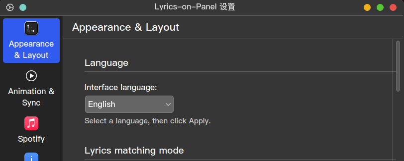
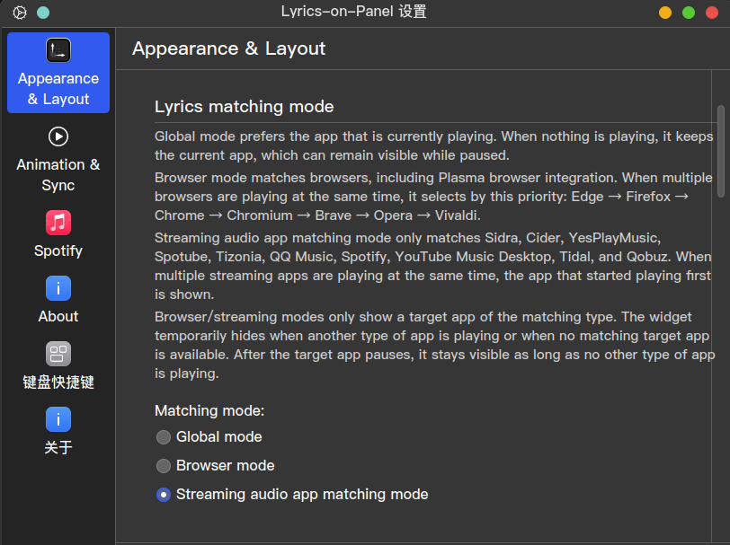
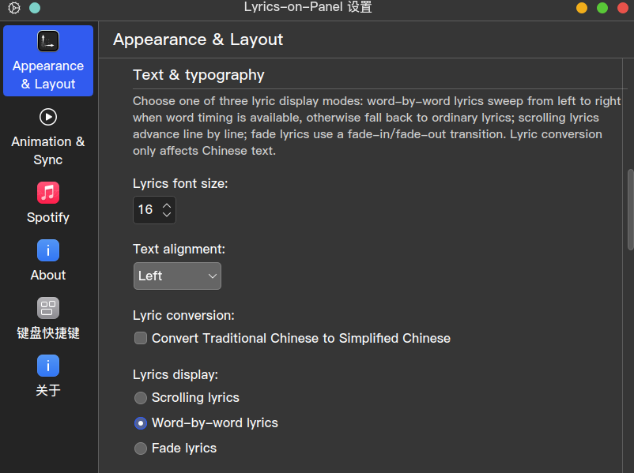
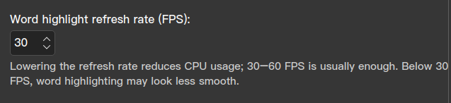

<h1 align="center">Lyrics-on-Panel-IMPRU</h1>

<p align="center"><a href="./Readme-cn.md">简体中文版Readme</a></p>

<p align="center">
  
</p>


<p align="center"><b>A KDE widget that supports real-time word-by-word lyrics display</b></p>

<p align="center">
    
      
</p>


**Need the installation steps?** -> [Jump to installation](#installation--uninstallation)


## Project Background
This project started from [lyrics-on-panel](https://github.com/KangweiZhu/lyrics-on-panel), originally created by [KangweiZhu](https://github.com/KangweiZhu). Its v3.0/3.1 release was forked and improved by [bogeta329](https://github.com/bogeta329) into [lyrics-on-panel-v3](https://github.com/bogeta329/lyrics-on-panel-v3). I then took [bogeta329](https://github.com/bogeta329)'s code and added a few extra features I wanted this tool to have.

Many thanks to both developers and to the contributors of their respective repositories!

## Key Improvements

### 1. Multilingual Support
The widget currently supports **Simplified Chinese, Traditional Chinese, English, Spanish, Russian, and German**. It should be the first thing you notice in the widget's configuration UI.

I'm not sure whether speakers of other languages would also want this widget. If you do, feel free to open an issue!



### 2. Lyrics Matching Mode

Supported modes are **Global mode, Browser mode, and Audio streaming app matching mode**.
When you pick a mode, the widget only matches lyrics for the applications you actually need lyrics from.

This is mainly to prevent the widget from matching lyrics against video titles while you're watching videos or attending classes, which would waste resources for no reason.




### 3. Word-by-Word Lyrics and Simplified/Traditional Chinese Conversion

**Simplified/Traditional conversion:** Some songs only have Traditional Chinese lyric sources, which isn't very friendly to users like me who read Simplified Chinese (the ideographs don't hurt comprehension, but I'm a bit obsessive about it (doge)). The widget offers Traditional-to-Simplified conversion, so people with the same obsession as me can rest easy 😁

**Word-by-word lyrics:** I noticed that most of the lyric sources chosen by the original author support karaoke-style lyrics, so I added this feature: the corresponding line is highlighted as the singer sings it. If a lyric source doesn't support word-by-word lyrics, the widget automatically falls back to normal mode.



### 4. Frame Rate Setting for Word-by-Word Lyrics
You can adjust the frame rate to reduce CPU usage. In my testing, 30 FPS is plenty.



## Existing Features

### About Spotify Integration
This feature has quite a lot going on. Since my network environment means I can't use Spotify anyway, please refer to the Readme in [bogeta329](https://github.com/bogeta329)'s [lyrics-on-panel-v3](https://github.com/bogeta329/lyrics-on-panel-v3). I won't go into detail here.

### About Font Size Adjustment and Some Underlying Infrastructure...
These should come from [lyrics-on-panel](https://github.com/KangweiZhu/lyrics-on-panel), created by [KangweiZhu](https://github.com/KangweiZhu). Its Readme.md seems to contain a detailed explanation of how the software works, which is probably largely the same in my improved version.


## Installation & Uninstallation

### Installation

#### Clone this repository

```bash
git clone https://github.com/XFTY/Lyrics-on-Panel-IMPRU
```
 
#### Run install.sh

```bash
cd [clone-path]
./install.sh
```
#### For automated scripts, you can also add the ```--yes``` flag

```bash
./install.sh --yes
```

### Uninstallation

#### Run uninstall.sh
```bash
./uninstall.sh
```

#### To remove all data completely, you can also add the ```--purge``` flag
```bash
./uninstall.sh  --purge
```

## Contributing

I may not have time to handle issues and PRs in the near future, so please bear with me. But if I do find the time, I'll get to them!
